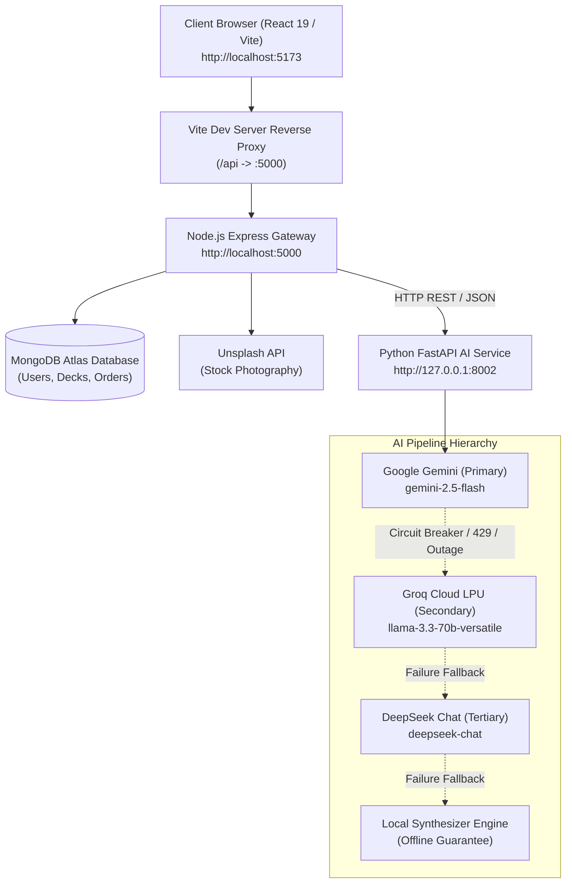

# PresentMaker — AI-Powered Presentation Maker

> An enterprise-grade, full-stack AI presentation platform that automates the complete presentation lifecycle: **Create** $\rightarrow$ **Understand** $\rightarrow$ **Practice** $\rightarrow$ **Present** $\rightarrow$ **Share**.

---

## 1. Project Overview

**PresentMaker** transforms prompts and documents into professional, visually structured presentation slide decks. Built with a modern 3-tier architecture (React 19 + Node.js Express + Python FastAPI), it features intelligent visual layout selection, automatic stock photography insertion via Unsplash, an AI educational tutor (**Teach Me**), interactive speech-coaching (**Practice Mode**), full-screen voice narration (**Present Mode**), multi-format export capabilities (PPTX, PDF, PNG, HTML), and a community **Template Marketplace**.

To ensure high availability and continuous operation, the system employs a **resilient 4-tier cascading AI pipeline**: Google Gemini is the primary engine, backed by an automated secondary fallback to Groq Cloud LPU (`llama-3.3-70b-versatile`), a tertiary fallback to DeepSeek, and an offline local synthesis engine.

---

## 2. Core Implemented Platform Features

> **Verification Status Notice:** All features listed below have undergone complete architectural implementation and static code compilation review. Live end-to-end presentation generation and functional validation are explicitly reserved for manual testing by the project owner.

- **Topic & Document Ingestion:** Generate structured decks from natural language prompts or uploaded reference documents (PDF, DOCX, PPTX).
- **14 Contextual Visual Slide Layouts:** Automatic layout selection including Two-Column, Cards Grid, Vertical Timeline, Metrics Callout, Process Flow, Comparison Table, Table Matrix, Hierarchy Tree, Profile Card, and Standard layouts.
- **Context-Aware Photography:** Intelligent Unsplash API integration that evaluates slide content and attaches relevant high-resolution stock photography.
- **AI Tutor ("Teach Me"):** Slide-by-slide learning module breaking down technical concepts with analogies, real-world examples, and terminology glossaries.
- **Interactive Practice & Speech Coaching:** Rehearsal studio utilizing browser Speech-to-Text (STT) to analyze spoken pace (WPM), clarity, keyword coverage, and delivery score.
- **Widescreen Present Mode:** Full-screen presentation delivery with automated multi-voice Text-to-Speech (TTS) narration for slide speaker notes.
- **Multi-Format Exports:** Binary export to Microsoft PowerPoint (`.pptx`), Adobe PDF (`.pdf`), high-resolution PNG image packages, interactive HTML decks, and raw JSON.
- **Community Discovery & Template Marketplace:** Template publishing, freemium AI credit tracking, listing ratings, reviews, and payment order flows.
- **Super Admin Dashboard:** User management, platform analytics, audit logging, and marketplace listing moderation.
- **High-Availability AI Fallback:** Primary Google Gemini engine with circuit-breaker failover to Groq (`llama-3.3-70b-versatile`) and offline synthesizer safety net.

---

## 3. Technology Stack & Detected Versions

| Layer | Technologies & Frameworks | Detected Versions |
| :--- | :--- | :--- |
| **Frontend UI** | React, TypeScript, Vite, TailwindCSS, Lucide React | React `19.2.8`, Vite `8.2.0`, TailwindCSS `4.3.3`, Node `>=20` |
| **Backend Gateway** | Node.js, Express, TypeScript, Mongoose, JWT, bcrypt | Express `4.21.2`, TypeScript `5.7.3`, Mongoose `8.9.5` |
| **AI Microservice** | Python, FastAPI, Uvicorn, Pydantic, python-pptx, reportlab | Python `3.10–3.14`, FastAPI `>=0.110.0`, Pydantic `>=2.6.4` |
| **Database** | MongoDB Atlas / Local MongoDB Server | MongoDB `7.x` |
| **Primary AI Provider** | Google Gemini Generative AI | `gemini-2.5-flash` / `gemini-2.0-flash` |
| **Fallback AI Provider** | Groq Cloud LPU (OpenAI-compatible) | `llama-3.3-70b-versatile` |
| **Image Provider** | Unsplash REST API | Official Unsplash Developer API |
| **Audio & TTS** | Microsoft Edge-TTS / Web Speech API | Edge-TTS Python Engine + Browser STT |

---

## 4. System Architecture



---

## 5. Repository Structure

```
PresentMaker/
├── .gitignore                      # Root exclusion rules (secrets, venv, node_modules)
├── README.md                       # Master project overview and quickstart
├── CONTRIBUTING.md                 # Development workflow and PR guidelines
├── SECURITY.md                     # Security policy, JWT rules, and data scoping
├── docs/                           # Complete technical documentation
│   ├── PROJECT_ARCHITECTURE.md     # 3-tier architecture, system diagram, fallback
│   ├── INSTALLATION_GUIDE.md       # Step-by-step setup for all operating systems
│   ├── API_DOCUMENTATION.md        # Full REST endpoint reference for Node and FastAPI
│   ├── DATABASE_SETUP.md           # MongoDB models, schema, and connection guide
│   ├── AI_PROVIDER_CONFIGURATION.md# Gemini, Groq, circuit breaker, and keys
│   ├── TEAM_HANDOVER.md            # FYP team quickstart and onboarding
│   └── PROJECT_STRUCTURE.md        # Codebase directory and file map
├── frontend/                       # React 19 + TypeScript + Vite frontend
├── backend-node/                   # Node.js + Express + TypeScript API gateway
└── backend/                        # Python + FastAPI + Uvicorn AI microservice
```

---

## 6. Prerequisites

Before installing the project, verify that the following tools are installed:

- **Node.js:** `>= 20.0.0` (Recommended: `v24.x LTS`)
- **npm:** `>= 9.0.0` (Recommended: `11.x`)
- **Python:** `3.10.x`, `3.11.x`, `3.12.x`, or `3.14.x`
- **Git:** Latest version
- **VS Code:** Recommended editor
- **MongoDB:** MongoDB Atlas account or local MongoDB Community Server

---

## 7. Installation Guide

### Step 1: Clone the Repository
```bash
git clone https://github.com/gul310/Presentation_Maker.git
cd Presentation_Maker
```

### Step 2: Install Frontend Dependencies
```bash
cd frontend
npm install
cd ..
```

### Step 3: Install Node Backend Dependencies
```bash
cd backend-node
npm install
cd ..
```

### Step 4: Set Up Python AI Microservice
```powershell
cd backend
python -m venv venv
.\venv\Scripts\Activate.ps1
pip install -r requirements.txt
cd ..
```

---

## 8. Exact Run Commands

### Option A: One-Click Startup (All Services)
You can launch all three services simultaneously using the root startup script:

- **Windows PowerShell:**
  ```powershell
  .\start_all_services.ps1
  ```
- **Linux / macOS Bash:**
  ```bash
  chmod +x start_all_services.sh
  ./start_all_services.sh
  ```

### Option B: Individual Terminals (Three Terminals)

Open three separate terminals in VS Code or your terminal application:

### Terminal 1 — Frontend UI
```powershell
cd frontend
npm run dev
```
> **UI URL:** [http://localhost:5173](http://localhost:5173)

### Terminal 2 — Node.js API Gateway
```powershell
cd backend-node
npm run dev
```
> **Gateway Port:** `http://localhost:5000`

### Terminal 3 — Python FastAPI AI Microservice
```powershell
cd backend
.\venv\Scripts\Activate.ps1
python -m uvicorn app.main:app --host 127.0.0.1 --port 8002
```
> **Swagger API Docs:** [http://127.0.0.1:8002/docs](http://127.0.0.1:8002/docs)

---

## 9. Environment Configuration

Each collaborator must configure their own local private `.env` files. Private `.env` files are strictly excluded from version control by `.gitignore` and must never be committed.

Copy the provided example template files into your own private `.env` files:

```powershell
# In backend-node:
Copy-Item backend-node\.env.example backend-node\.env

# In backend:
Copy-Item backend\.env.example backend\.env

# In frontend:
Copy-Item frontend\.env.example frontend\.env
```

*(On Linux / macOS, use `cp backend-node/.env.example backend-node/.env`, etc.)*

### Required Variables:
- **`backend-node/.env`:**
  - `MONGODB_URI`: Your MongoDB Atlas URI or local `mongodb://127.0.0.1:27017/presentmaker`.
  - `JWT_SECRET`: Random 32+ character secret string.
  - `UNSPLASH_ACCESS_KEY` & `UNSPLASH_SECRET_KEY`: (Optional) Free Unsplash developer keys.
- **`backend/.env`:**
  - `GEMINI_API_KEY`: API key from [Google AI Studio](https://aistudio.google.com/).
  - `GROQ_API_KEY`: (Optional secondary fallback) API key from [Groq Console](https://console.groq.com/keys).
  - `JWT_SECRET_KEY`: Must match `JWT_SECRET` in `backend-node/.env`.
- **`frontend/.env`:**
  - `VITE_API_URL`: `/api` (proxied to backend gateway by Vite in dev mode).

---

## 10. Database Setup

PresentMaker uses MongoDB with Mongoose ODM.
1. Connect via `MONGODB_URI` in `backend-node/.env`.
2. All schemas (`User`, `Presentation`, `GenerationJob`, `MarketplaceListing`, `AuditLog`, etc.) are created dynamically by Mongoose on first insert.
3. A single dedicated Super Administrator account seed (`admin@presentai.com`) runs safely on startup. No other account is automatically granted administrator privileges.
4. Detailed database schema documentation is available in [docs/DATABASE_SETUP.md](file:///c:/Users/admin/Downloads/PresentMaker/docs/DATABASE_SETUP.md).

---

## 11. AI Provider Configuration & Fallback

Detailed provider setup instructions are documented in [docs/AI_PROVIDER_CONFIGURATION.md](file:///c:/Users/admin/Downloads/PresentMaker/docs/AI_PROVIDER_CONFIGURATION.md).
- **Gemini (Primary):** Model `gemini-2.5-flash`.
- **Groq (Secondary Fallback):** Model `llama-3.3-70b-versatile`.
- **Circuit Breaker:** Automatically trips after 3 consecutive errors, directing traffic to Groq for 30 seconds before attempting recovery.
- **Modality Boundaries:** Audio generation (Edge-TTS) and image search (Unsplash) are strictly decoupled from text LLM providers.

---

## 12. API Documentation

Detailed REST API endpoints are documented in [docs/API_DOCUMENTATION.md](file:///c:/Users/admin/Downloads/PresentMaker/docs/API_DOCUMENTATION.md).
- **Node.js Gateway:** `/api/auth`, `/api/presentations`, `/api/ai`, `/api/images`, `/api/marketplace`, `/api/admin`.
- **Python AI Microservice:** `/ai/generate`, `/ai/upload-source`, `/ai/teach-slide`, `/ai/refine-slide`, `/ai/evaluate-practice`, `/ai/translate-slide`, `/ai/tts/synthesize`, `/ai/export/{format}`.

---

## 13. Common Troubleshooting

| Issue | Cause | Solution |
| :--- | :--- | :--- |
| **Port 5000 / 8002 in use** | Lingering background process | Stop process: `Get-Process node, python \| Stop-Process` |
| **MongoDB Atlas connection timeout** | IP not whitelisted | Add current IP or `0.0.0.0/0` in Atlas Network Access |
| **PowerShell script execution error** | Execution policy restriction | Run: `Set-ExecutionPolicy -ExecutionPolicy RemoteSigned -Scope CurrentUser` |
| **AI generation failure (429 / Outage)**| Gemini quota exceeded | System automatically falls back to Groq if `GROQ_API_KEY` is provided |

---

## 14. Development & Team Guidelines

- Follow the branching strategy documented in [CONTRIBUTING.md](file:///c:/Users/admin/Downloads/PresentMaker/CONTRIBUTING.md).
- Adhere to the security policies in [SECURITY.md](file:///c:/Users/admin/Downloads/PresentMaker/SECURITY.md).
- Check [docs/TEAM_HANDOVER.md](file:///c:/Users/admin/Downloads/PresentMaker/docs/TEAM_HANDOVER.md) for quick onboarding steps.

---

## 15. Project Status

- **IMPLEMENTATION:** COMPLETED
- **STATIC CODE AUDIT:** COMPLETED (0 syntax errors, clean builds in frontend and backend)
- **TESTING POLICY:** **NOT PERFORMED — RESERVED FOR USER**
