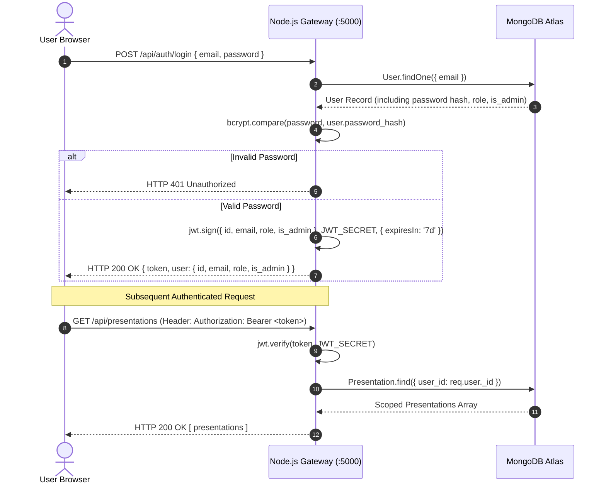
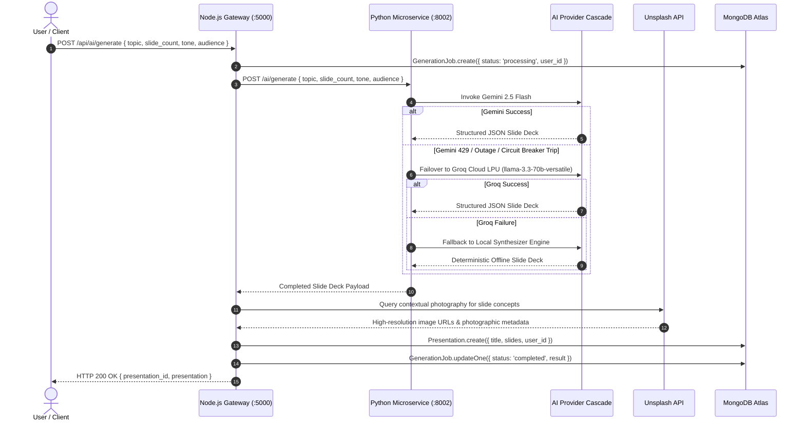

# PresentMaker — System Architecture & Implementation Reference

This document provides a comprehensive technical overview of the **PresentMaker** multi-tier system architecture, service interactions, data flow, security boundaries, and resilience mechanisms based directly on the actual codebase.

---

## 1. System Architecture Overview

PresentMaker is implemented as an enterprise-grade 3-tier distributed web application:

```mermaid
flowchart TD
    Client["Client Browser (React 19 / Vite)\nhttp://localhost:5173"]
    ViteProxy["Vite Dev Server Proxy\n(/api/* -> http://localhost:5000)"]
    Gateway["Node.js Express Gateway\nhttp://localhost:5000"]
    Database[("MongoDB Atlas Database\n(Users, Decks, Jobs, Orders)")]
    UnsplashAPI["Unsplash REST API\n(Contextual Photography)"]
    FastAPI["Python FastAPI AI Microservice\nhttp://127.0.0.1:8002"]
    
    subgraph AI Provider Cascade
        Gemini["Google Gemini 2.5 Flash\n(Primary Engine)"]
        Groq["Groq Cloud LPU (Llama-3.3-70b)\n(Secondary Circuit-Breaker Fallback)"]
        DeepSeek["DeepSeek Chat\n(Tertiary Fallback)"]
        Synthesizer["Local Synthesizer Engine\n(Deterministic Offline Safety Net)"]
    end

    Client --> ViteProxy
    ViteProxy --> Gateway
    Gateway --> Database
    Gateway --> UnsplashAPI
    Gateway -->|HTTP REST / JSON| FastAPI
    FastAPI --> Gemini
    Gemini -.->|Circuit Breaker (3 Failures / 429)| Groq
    Groq -.->|Failure Fallback| DeepSeek
    DeepSeek -.->|Failure Fallback| Synthesizer
```

---

## 2. Core Service Responsibilities

### 2.1 Presentation Layer: React 19 Frontend (`frontend/`)
- **Framework & Tooling:** React `19.2.8`, TypeScript `5.7.2`, Vite `8.2.0`, Tailwind CSS `4.3.3`, Lucide React icons.
- **Development Proxy:** In development, Vite automatically routes all `/api/*` network requests to `http://localhost:5000`.
- **Application Pages:**
  - `CreatePage`: Multi-step deck creation (prompt input, document upload, tone, audience, slide count).
  - `EditorPage`: Interactive slide studio with real-time text editing, theme switching, layout selection, and Unsplash photo insertion.
  - `PresentationViewPage`: Clean widescreen presentation viewer.
  - `TeachMePage`: Slide-by-slide AI educational tutoring breakdown.
  - `PracticeModePage`: Speech-to-text rehearsal studio with real-time WPM pace tracking and feedback.
  - `MarketplacePage`: Community template discovery, ratings, reviews, and template copying.
  - `AdminDashboardPage`: Super Administrator control center (user metrics, role management, audit logs).
  - `LoginPage` / `RegisterPage`: User authentication and session creation.
- **Visual Slide Renderer (`VisualSlideRenderer.tsx`):**
  - Renders 14 responsive contextual slide layouts: `title`, `two-column`, `cards-grid`, `timeline-vertical`, `metrics-callout`, `process-steps`, `comparison-table`, `table-matrix`, `hierarchy-tree`, `profile-card`, `quote-center`, `code-block`, `standard`.
  - Enforces strict overflow containment (`overflow-hidden`, `min-w-0`, `[overflow-wrap:anywhere]`) and fluid responsive typography to eliminate layout breakages.

---

### 2.2 API Gateway & Orchestration: Node.js Express Gateway (`backend-node/`)
- **Runtime & Tooling:** Node.js `>=20.0.0`, Express `4.21.2`, TypeScript `5.7.3`, Mongoose `8.9.5`, `jsonwebtoken`, `bcryptjs`.
- **Primary Responsibilities:**
  - **Authentication & RBAC:** Issues and verifies JSON Web Tokens (JWT), validates user passwords using `bcryptjs` salt rounds, and enforces Super Administrator authorization via `requireAdmin`.
  - **Tenant Data Isolation:** Ensures every presentation read, update, or delete operation filters strictly by `{ _id: presentationId, user_id: req.user._id }`.
  - **Asynchronous AI Job Management:** Manages `GenerationJob` lifecycle (`pending` $\rightarrow$ `processing` $\rightarrow$ `completed` / `failed`) for long-running slide generations.
  - **Stock Photography Enrichment:** Connects to the Unsplash API (`unsplash.service.ts`), generating semantic keywords from slide contents and enriching slides with high-resolution photography.
  - **Proxy to AI Microservice:** Routes structured generation and document parsing requests to the Python FastAPI microservice at `http://127.0.0.1:8002`.

#### Express Route Structure:
| Route Path | Handler File | Description | Protection Level |
| :--- | :--- | :--- | :--- |
| `/api/auth` | `auth.routes.ts` | Login, registration, profile (`/me`), password updates | Public / Authenticated |
| `/api/presentations` | `presentation.routes.ts` | CRUD operations for user slide decks | Authenticated (`req.user`) |
| `/api/ai` | `ai.routes.ts` | Presentation generation dispatch, async job polling | Authenticated / Guest |
| `/api/images` | `image.routes.ts` | Unsplash photo searches and curated collections | Authenticated |
| `/api/marketplace` | `marketplace.routes.ts` | Public template discovery, listing creation, orders | Public / Authenticated |
| `/api/admin` | `admin.routes.ts` | User audits, system statistics, listing moderation | Super Admin Only |
| `/api/practice` | `practice.routes.ts` | Rehearsal score persistence and speech analytics | Authenticated |
| `/api/guest` | `guest.routes.ts` | Guest session tracking (max 2 free generations) | Public (Session Cookie) |

---

### 2.3 Intelligence Engine: Python FastAPI AI Microservice (`backend/`)
- **Runtime & Tooling:** Python `3.10–3.14`, FastAPI `>=0.110.0`, Uvicorn, Pydantic `2.x`, `python-docx`, `pypdf`, `python-pptx`, `reportlab`, `edge-tts`.
- **Microservice Endpoints (`backend/app/api/ai_microservice.py`):**
  - `POST /ai/generate`: Executes multi-slide deck generation with dynamic timeout scaling (`15s + slide_count * 1.5s`).
  - `POST /ai/upload-source`: Ingests DOCX, PDF, and PPTX documents, performs intelligent title extraction, strips document noise, and outputs structured section summaries.
  - `POST /ai/teach-slide`: Generates educational tutor explanations with analogies, real-world examples, and terminology definitions.
  - `POST /ai/refine-slide`: Rewrites slide text on demand (simplify, expand, formalize, bullet-point).
  - `POST /ai/evaluate-practice`: Analyzes rehearsal transcripts for pace (WPM), clarity score, keyword coverage, and delivery strengths.
  - `POST /ai/translate-slide`: Translates slide content into multiple languages.
  - `POST /ai/export/{format}`: Compiles slide decks into Microsoft PowerPoint (`.pptx`), Adobe PDF (`.pdf`), PNG image zip archives, interactive standalone HTML, speaker notes, and JSON.
  - `POST /ai/tts/synthesize`: Synthesizes spoken voice audio for speaker notes using Microsoft Edge-TTS.

---

### 2.4 Data Layer: MongoDB Atlas (`backend-node/src/models/`)
- **Database Architecture:** Cloud-hosted MongoDB Atlas (or local MongoDB Community Server `7.x`) accessed via Mongoose ODM.
- **Core Collections & Schemas:**
  - `User`: Email, hashed password, display name, role (`admin` or `student`), `is_admin` boolean flag, AI credit balance, timestamps.
  - `Presentation`: Presentation title, topic, theme, slides array (title, bullets, layout, image URL, speaker notes), `user_id` ownership reference, visibility flag (`is_public`), timestamps.
  - `GenerationJob`: Background generation job state (`pending`, `processing`, `completed`, `failed`), error messages, completed payload.
  - `MarketplaceListing`: Template title, description, category, tags, pricing, author `user_id`, download counter, rating average.
  - `AuditLog`: System security events, administrative role updates, sensitive operational logs.
  - `Order`: Marketplace transaction logs, buyer `user_id`, listing reference.
  - `GuestSession`: Ephemeral session tokens tracking unauthenticated generation counts against the limit of 2.

---

## 3. End-to-End Authentication & JWT Lifecycle



---

## 4. Presentation Generation & AI Fallback Lifecycle



---

## 5. Document Ingestion & Title Intelligence Architecture

When a user uploads a reference document (DOCX, PDF, PPTX):
1. **File Upload:** The client uploads the binary document file to the backend.
2. **Text Extraction:** In `document_service.py`, specialized parsers extract text streams:
   - DOCX: Evaluated paragraph-by-paragraph via `python-docx`.
   - PDF: Streamed and parsed page-by-page via `pypdf`.
   - PPTX: Shape and text-frame extraction via `python-pptx`.
3. **Intelligent Title Extraction (`extract_intelligent_title`):**
   - Evaluates document metadata (Core Title Property).
   - Scans structural Heading 1 elements.
   - Detects the first prominent non-header headline, stripping academic metadata, dates, and author lines.
   - If no valid document title is found, it cleans the filename (`clean_filename_to_title`), replacing underscores and hyphens with clean title casing.
4. **Noise Filtering & Content Chunking:**
   - Strips table-of-contents dotted leader lines (`....`).
   - Removes repeated page headers, footers, and page numbers.
   - Balances content across the user-requested slide count, preventing single-slide raw text dumps.

---

## 6. Circuit Breaker & High-Availability Resilience

Implemented in `backend/app/services/ai_circuit_breaker.py`:
- **Closed State (Normal):** All generation traffic routes to the primary engine (Google Gemini `gemini-2.5-flash`).
- **Open State (Tripped):** After **3 consecutive failures** (or immediate HTTP 429 Quota Exceeded), the circuit trips to `OPEN`. Traffic immediately diverts to Groq Cloud LPU (`llama-3.3-70b-versatile`) without waiting for Gemini timeouts.
- **Half-Open State (Recovery Check):** After a **30-second cooldown window**, a single probe request checks whether Gemini has recovered. If successful, normal routing resumes; if it fails, the circuit re-opens for another 30 seconds.
- **Offline Local Synthesizer (`synthesizer.py`):** If both cloud providers fail or the machine is offline, the deterministic local synthesizer generates complete, well-formed slide presentations, guaranteeing zero server crashes.
