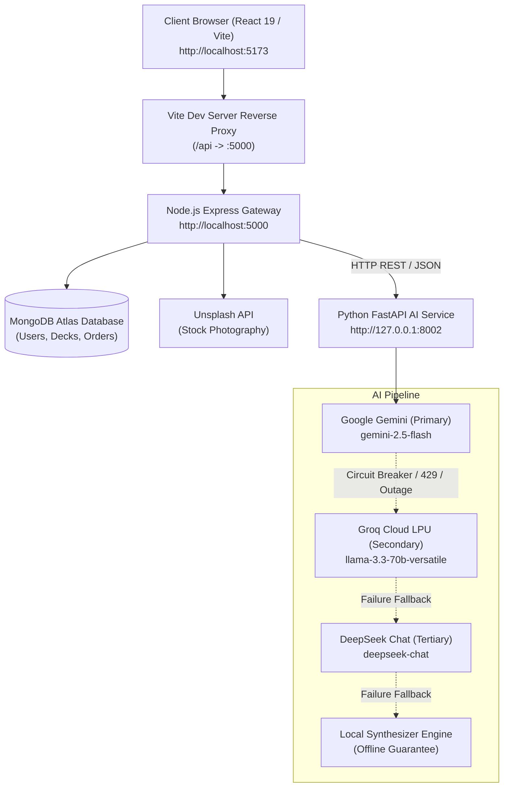

# PresentMaker — System Architecture

This document describes the high-level system architecture, service interactions, data flow, and resilience mechanisms of **PresentMaker**.

---

## 1. High-Level Architecture Overview

PresentMaker is designed as a modular 3-tier system:
1. **Presentation Layer (Frontend):** React 19 + TypeScript + Vite running on port `5173`. Proxies `/api` requests to port `5000`.
2. **API Gateway & Core Logic (Node Backend):** Express + TypeScript + MongoDB Mongoose running on port `5000`. Manages user authentication, data persistence, access control, guest limits, marketplace orders, and asynchronous presentation generation queues.
3. **AI & Document Processing Engine (Python AI Microservice):** FastAPI + Uvicorn running on port `8002`. Handles document text extraction (PDF, DOCX, PPTX), LLM prompt synthesis, multi-layout slide generation, speech coaching evaluation, multilingual translation, text-to-speech narration, and presentation export generation.

---

## 2. Component Communication & Responsibilities

### 2.1 Frontend (`frontend/`)
- Built with React 19, TypeScript, TailwindCSS v4, and Lucide React.
- Provides 14 distinct visual slide layouts (`two-column`, `cards-grid`, `timeline-vertical`, `metrics-callout`, `process-steps`, `table-matrix`, `hierarchy-tree`, etc.).
- Features:
  - **Create Studio:** Prompt-based generation, document uploads, audience and tone selectors.
  - **Presentation Studio:** Interactive WYSIWYG slide editor with Unsplash photo placement.
  - **Teach Me:** AI educational tutor breaking down complex slides with analogies.
  - **Practice Mode:** Rehearsal with speech recognition and objective scoring.
  - **Present Mode:** Full-screen widescreen delivery with text-to-speech voice narration.
  - **Discovery & Marketplace:** Community template sharing and listing purchases.
  - **Super Admin Panel:** User management, role audits, platform settings, and transaction tracking.

### 2.2 Node Backend Gateway (`backend-node/`)
- Express 4 server compiled from TypeScript.
- Authenticates users with JWT and hashes passwords using bcrypt.
- Enforces strict data isolation on all presentation CRUD endpoints (`user_id` query scoping).
- Background queue / asynchronous polling via `GenerationJob` model.
- Unsplash image orchestration: selects photos contextually based on slide content and inserts high-resolution image URLs.

### 2.3 Python AI Microservice (`backend/`)
- FastAPI application running under Uvicorn.
- Document extraction: parses text and structure from PDF (`pypdf`), DOCX (`python-docx`), and PPTX (`python-pptx`).
- Dynamic Prompt Engineering: injects structure and schema constraints to generate verified slide items with custom layouts.
- Dynamic Timeout Scaling: scales generation timeouts (`15s + slide_count * 1.5s`) up to 60 seconds to prevent aborts during large deck creation.
- Multi-format Exporters: exports slide decks to PPTX (`python-pptx`), PDF (`reportlab`), PNG image archives, HTML interactive decks, speaker notes, and package ZIPs.

---

## 3. Resilience & AI Fallback Architecture

To ensure high availability and prevent failures due to API rate limits (429) or cloud outages, the AI microservice implements a 4-tier cascading fallback:

1. **Tier 1 — Google Gemini (Primary):**
   - Configured with `gemini-2.5-flash`, with automatic candidate model failover (`gemini-2.0-flash`, `gemini-1.5-flash`).
2. **Tier 2 — Groq Cloud LPU (Secondary Fallback):**
   - Fast, low-latency inference using `llama-3.3-70b-versatile` via Groq's official API (`https://api.groq.com/openai/v1`).
   - Uses native JSON mode (`response_format={"type": "json_object"}`).
3. **Tier 3 — DeepSeek Chat (Tertiary Fallback):**
   - Invoked if configured and both Gemini and Groq fail.
4. **Tier 4 — Deterministic Local Synthesizer (`synthesizer.py`):**
   - Fallback engine that runs locally without internet access, ensuring zero server crashes.

### Circuit Breaker Specification (`app/services/ai_circuit_breaker.py`)
- **Closed State:** Normal operation. Requests route to primary provider.
- **Open State:** Triggered after 3 consecutive errors. Requests fail-fast directly to the secondary provider for 30 seconds.
- **Half-Open State:** After 30 seconds, a single test request checks provider recovery.

